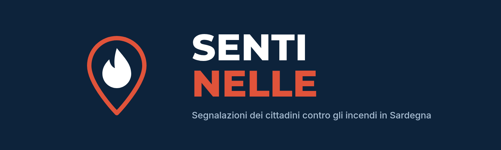
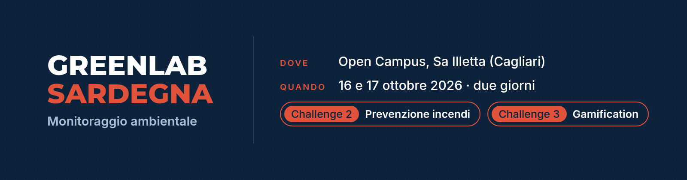
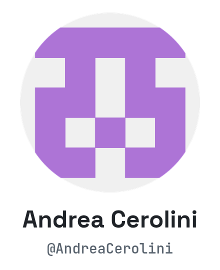
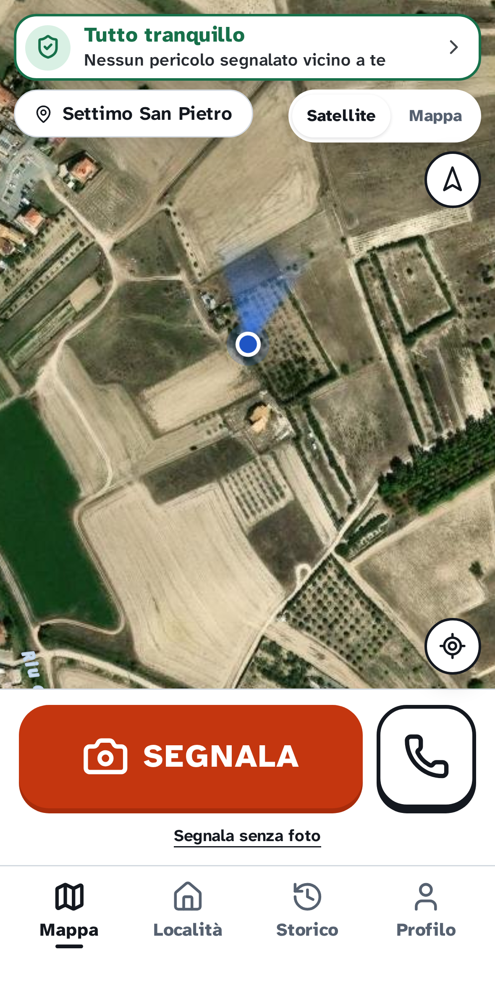
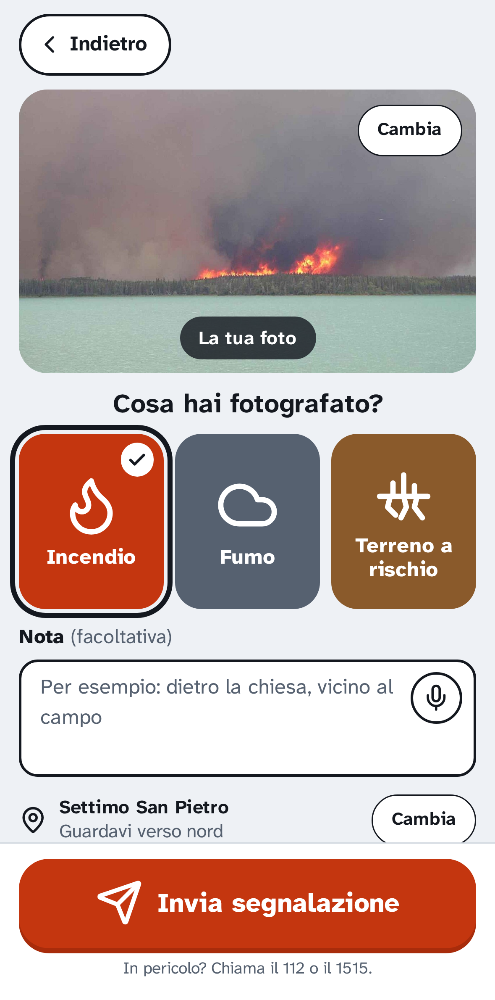
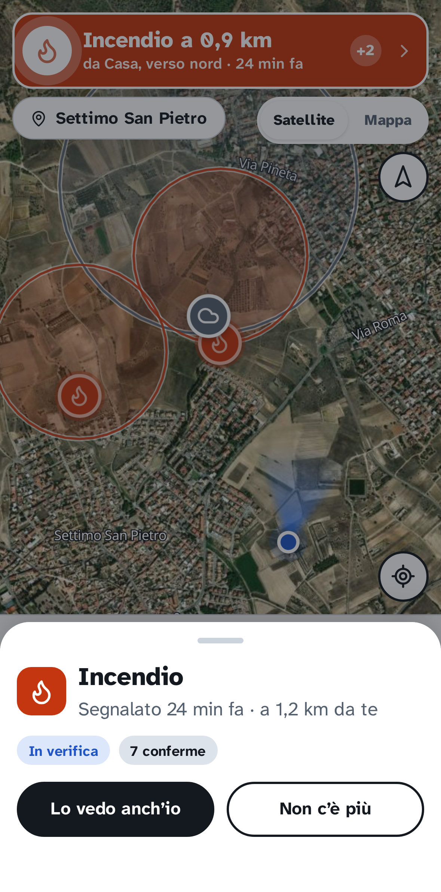
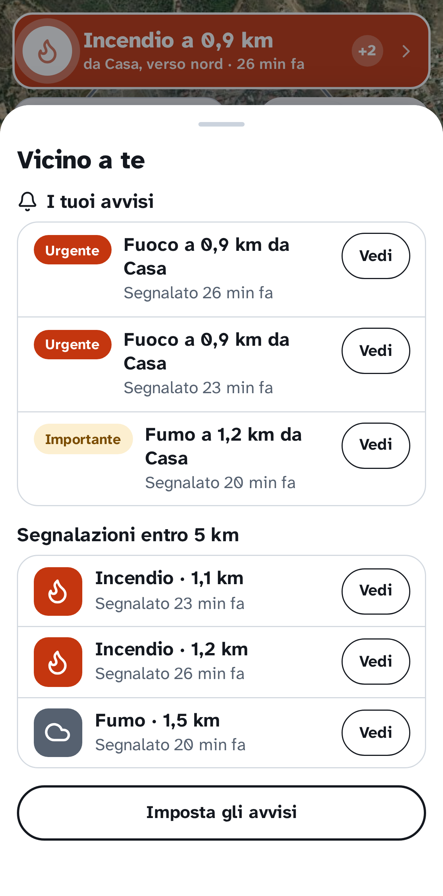
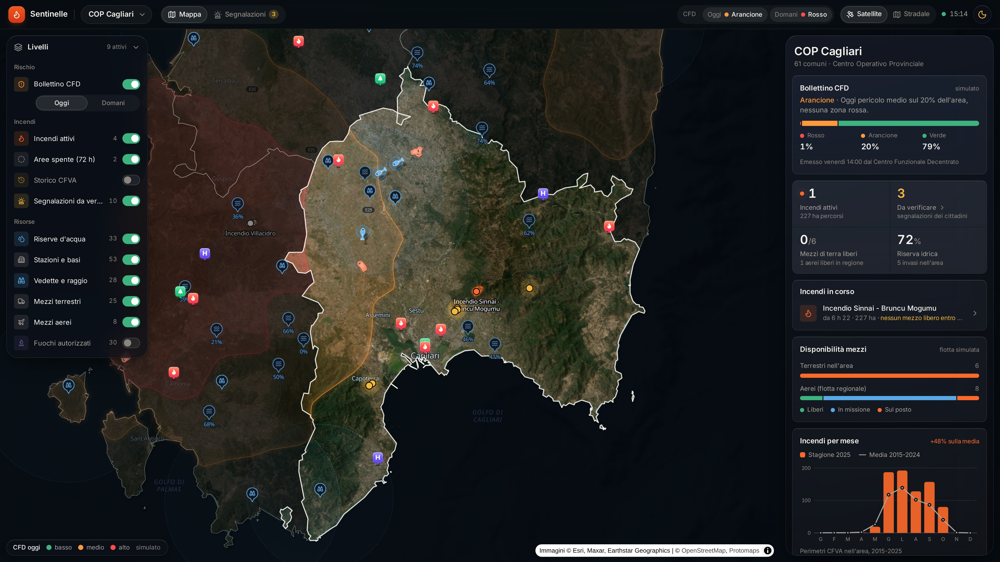
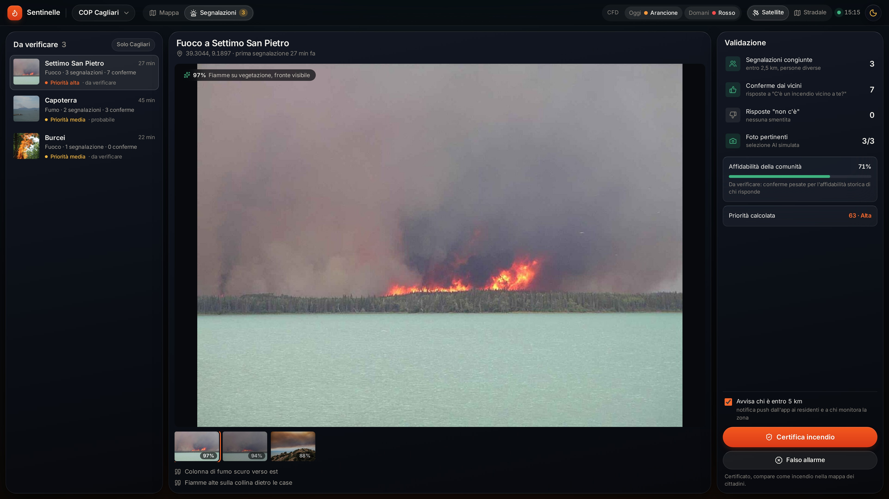

<p align="center">
  
</p>

<p align="center">
  <b>I cittadini segnalano incendi e completano missioni di prevenzione; gli operatori ricevono le segnalazioni già verificate e ordinate per priorità.</b><br>
  <sub>GreenLab Sardegna Hackathon · Cagliari · Challenge 2 + Challenge 3 · realizzato il 16 e 17 ottobre 2026 dal team CyberGuys</sub>
</p>

<p align="center">
  
  
  
  
  
  
  
</p>

## Realizzato al GreenLab Sardegna Hackathon

<p align="center">
  
</p>

Sentinelle è nato in due giorni al **GreenLab Sardegna Hackathon**, dedicato al monitoraggio ambientale, il 16 e 17 ottobre 2026 all'Open Campus di Sa Illetta, a Cagliari. L'evento è stato organizzato dalla Camera di Commercio di Cagliari-Oristano, con il Centro Regionale di Programmazione della Regione Sardegna e Promocamera di Sassari, nell'ambito del progetto europeo CIIRCLE (Interreg Italia-Francia Marittimo).

Abbiamo unito in un solo prodotto due delle cinque challenge, entrambe sugli incendi: la **2** (prevenzione con il coinvolgimento dei cittadini) e la **3** (gamification per coinvolgere comunità locali e giovani). Sentinelle ha vinto il **2° posto**. Le challenge e i criteri di valutazione sono in [L'hackathon](#lhackathon).

## Team

Team **CyberGuys**, un team di hackathon dalla Sardegna.

<p align="center">
  <a href="https://github.com/uNickz"><picture><source media="(prefers-color-scheme: dark)" srcset="docs/assets/team/uNickz-dark.png"></picture></a>&nbsp;&nbsp;
  <a href="https://github.com/AndreaCerolini"><picture><source media="(prefers-color-scheme: dark)" srcset="docs/assets/team/AndreaCerolini-dark.png"></picture></a>&nbsp;&nbsp;
  <a href="https://github.com/NicoXVI"><picture><source media="(prefers-color-scheme: dark)" srcset="docs/assets/team/NicoXVI-dark.png"></picture></a>&nbsp;&nbsp;
  <a href="https://github.com/ale24cocco"><picture><source media="(prefers-color-scheme: dark)" srcset="docs/assets/team/ale24cocco-dark.png"></picture></a>
</p>

## Cosa fa Sentinelle

Le app per segnalare incendi di solito falliscono per due motivi: producono falsi allarmi che nessuno filtra, e si aprono solo durante un'emergenza, quindi sul telefono non ci sono quando servono. In Sardegna, nel 2025, ci sono stati 1362 incendi sopra i 1000 m², e circa l'85% è partito su superfici non boscate, cioè dove le persone ci sono.

Sentinelle trasforma le comunità locali in sentinelle del proprio territorio per tutto l'anno. Fuori stagione l'app propone missioni di prevenzione (mappare sterpaglie e rifiuti, verificare un punto d'acqua, quiz sul rischio del giorno) che danno punti e fanno salire il comune in classifica. Quando qualcuno segnala fuoco, fumo o un'area a rischio, il backend incrocia la segnalazione con satellite (hotspot FIRMS), meteo, vegetazione e storico degli incendi, e la manda agli operatori con una priorità da 0 a 100 e le motivazioni. Le segnalazioni di fuoco danno punti solo dopo la conferma di un operatore, così i falsi allarmi non convengono.

Gli operatori (Comune, Barracelli, Protezione Civile) lavorano dalla dashboard COP: mappa regionale con le aree del bollettino di rischio, coda delle segnalazioni da verificare, conferma o falso allarme, mezzi disponibili e simulazione di come può propagarsi un incendio nelle 24 ore successive.

<p align="center">
  
  
  
  
  <br><sub>L'app cittadino: si segnala con una foto, gli altri confermano, chi è vicino riceve l'avviso.</sub>
</p>

<p align="center">
  
  
  <br><sub>La dashboard COP: aree di rischio e mezzi a sinistra, una segnalazione da certificare a destra.</sub>
</p>

## Indice

- [L'hackathon](#lhackathon)
- [Avvio con Docker](#avvio-con-docker)
- [Mappa base della dashboard COP](#mappa-base-della-dashboard-cop)
- [Bollettino CFD simulato](#bollettino-cfd-simulato)
- [Avvio senza Docker](#avvio-senza-docker)
- [Prova da telefono](#prova-da-telefono)
- [Comandi utili](#comandi-utili)
- [Struttura del repository](#struttura-del-repository)
- [Materiali del pitch](#materiali-del-pitch)

## L'hackathon

Il **GreenLab Sardegna Hackathon** si è tenuto il 16 e 17 ottobre 2026, dalle 9 alle 18, all'Open Campus di Sa Illetta (Cagliari). Era aperto a studenti dell'Università di Cagliari e di Sassari e a cittadini, in team da 3 a 6 persone.

Le cinque challenge:

| # | Area | Domanda | Output atteso |
|---|---|---|---|
| 1 | Open data | Come risolvere la frammentazione tra i database ambientali sardi? | Dashboard web che unifica database diversi |
| **2** | **Incendi** | **Come supportare la prevenzione coinvolgendo i cittadini?** | **App mobile di allerta precoce con mappatura partecipata di aree a rischio e focolai** |
| **3** | **Incendi** | **Come coinvolgere comunità locali e giovani nella prevenzione?** | **Strumento di gamification (mini-game, app a premi, dinamiche interattive)** |
| 4 | Acqua | Come ottimizzare gestione e monitoraggio dei consumi idrici? | Piattaforma open source di raccolta e monitoraggio dei consumi |
| 5 | Open data | Come rendere i dataset ambientali fruibili a tutti? | Portale web con API semplificate |

La giuria ha valutato sei criteri. Ecco come risponde Sentinelle:

| Criterio | La nostra risposta |
|---|---|
| **Idea:** rispondenza alla sfida, fattibilità tecnica, creatività | Un'unica app risponde a entrambe le challenge sugli incendi: le missioni tengono l'app in uso tutto l'anno, la verifica incrociata toglie i falsi allarmi. |
| **Prototipo:** tecnologia impiegata e stadio di sviluppo | App cittadino e dashboard COP funzionanti su dati reali della Regione (perimetri CFVA 2005-2025, pericolo AIB, invasi), con aggiornamenti live, mappe offline e avvio con un solo comando Docker. Provato su telefono vero tramite tunnel HTTPS. |
| **Fattore novità:** valore aggiunto e innovazione | Le segnalazioni arrivano agli operatori già con una priorità spiegata fattore per fattore, e il gioco premia il fuoco solo dopo la conferma. |
| **Impatto sociale:** benefici per il territorio | Coinvolge chi vive dove partono gli incendi, durante tutto l'anno, e dà agli operatori meno rumore e più contesto. |
| **Gruppo di lavoro:** coinvolgimento e multidisciplinarietà | Quattro persone tra backend, app, dashboard, dati geografici e pitch. |
| **Presentazione:** originalità e chiarezza del pitch | Presentazione e trailer di 30 secondi realizzati per la sala, in [`docs/pitch/`](docs/pitch/). |

I documenti ufficiali (vademecum, criteri, dataset, template) sono in [`docs/materiali/`](docs/materiali/).

## Avvio con Docker

Serve Docker con compose, git e `gh` autenticato con accesso al repo (solo per scaricare il dump dei dati). Non servono Node, Python o conda sul sistema: tutto gira nei container, uguale per tutti.

```bash
./scripts/docker.sh                 # prima volta: scarica il dump dei dati (~140 MB), costruisce, ripristina, avvia (~2 min)
./scripts/docker.sh dev             # sviluppo: hot reload su backend e webapp
./scripts/docker.sh dev-dashboard   # sviluppo: hot reload sulla dashboard COP
./scripts/docker.sh bollettini 7    # genera i bollettini CFD simulati (vedi sotto, PC con almeno 16 GB di RAM)
./scripts/docker.sh down            # ferma (i dati restano); "down -v" riparte da zero
```

Sono tre servizi separati che parlano solo con il backend e usano lo stesso database, quindi una segnalazione fatta nell'app compare subito nella dashboard COP:

| Servizio | Cartella | Indirizzo |
|---|---|---|
| App cittadino (`webapp`) | `webapp/` | http://localhost:3000 |
| Dashboard COP operatori (`dashboard`) | `frontend/` | http://localhost:3001/dashboard |
| Backend (`backend`) | `backend/` | http://localhost:8000/salute |

Lo stack è leggero: webapp e dashboard sono statiche servite da nginx (~7 MB di RAM ciascuna), il backend usa ~100 MB e PostGIS ~300 MB. Le porte si cambiano con `SENTINELLE_PORTA_APP`, `SENTINELLE_PORTA_DASHBOARD` e `SENTINELLE_PORTA_API`. Senza `gh`, copia `sentinelle.dump` in `dati/` e lancia lo script. Per eseguire comandi nel backend: `./scripts/docker.sh exec -T backend python scripts/prova_webapp.py`. Le dipendenze Python sono bloccate in `backend/requirements.txt` (il comando per rigenerarle è in `backend/Dockerfile`).

Per provare l'app cittadino senza GPS (dal computer), aggiungi `?pos=39.4216,8.9223&dir=45` all'indirizzo: fissa posizione e direzione dello sguardo. Dal telefono usa l'indirizzo HTTPS del tunnel che lo script stampa a fine avvio (vedi [Prova da telefono](#prova-da-telefono)).

## Mappa base della dashboard COP

La mappa predefinita è quella **satellitare** (immagini Esri World Imagery, serve la rete). In alternativa c'è la **stradale** vettoriale, tutta offline. Si cambia dalla barra in alto e il browser ricorda la scelta. Se le immagini satellitari non arrivano (per esempio se cade la rete della sala) la dashboard passa da sola alla stradale e lo segnala.

## Bollettino CFD simulato

Le zone di rischio della dashboard vengono da un bollettino **simulato** del Centro Funzionale Decentrato (verde, arancione, rosso, emesso il giorno prima). Calcolarlo richiede ~10 s e molta RAM per ogni giorno, e su un portatile con poca memoria blocca il PC. Per questo il backend non lo calcola mai: legge i file JSON in `dati/bollettini/`, che si generano una volta su un PC capiente e si committano.

Chi li genera (PC con almeno 16 GB di RAM):

```bash
git pull                              # branch con la dashboard COP
./scripts/docker.sh                   # stack acceso e ricostruito col codice aggiornato
./scripts/docker.sh bollettini 7      # 7 giorni da oggi; per partire da un'altra data: bollettini 7 2026-10-20
git add dati/bollettini && git commit -m "bollettini CFD simulati" && git push
```

Il comando gira nel container del backend e scrive in `dati/bollettini/` un file per giorno (`bollettino-AAAA-MM-GG.json`, ~350 KB) più `aree-cop.json` con i confini delle 7 aree. Ci vogliono ~15 s per giorno. Senza Docker, con l'ambiente di `setup.sh`: `./scripts/python.sh scripts/genera_bollettino.py --giorni 7`.

Chi usa i file (anche il PC della demo) fa `git pull` e poi `./scripts/docker.sh`: i file entrano nell'immagine del backend alla build. Se manca il giorno richiesto, il backend usa il file del giorno più vicino; se non c'è nessun file, la mappa resta senza zone (tutto verde). Per la demo vanno generati i giorni dell'evento.

## Avvio senza Docker

Serve Docker acceso (per il database), Node >= 20, git e uno tra conda, uv o Python 3.12. Per i dati serve `gh` autenticato con accesso al repo. I dettagli sono in [`ONBOARDING.md`](ONBOARDING.md).

```bash
git clone https://github.com/Cyber-Guys/Sentinelle.git
cd Sentinelle
./scripts/setup.sh     # una volta: ambiente, dipendenze, database, dati demo (idempotente)
./scripts/avvia.sh     # ogni volta: backend + frontend, Ctrl+C ferma entrambi
```

- App cittadino (vecchia): http://localhost:3000/app (pensata per il telefono)
- Dashboard COP: http://localhost:3000/dashboard (`/cruscotto` reindirizza qui)
- API: http://localhost:8000/salute

Il browser chiama sempre `/api/**` e Nuxt lo inoltra al backend su :8000. In Claude Code gli stessi server partono da `.claude/launch.json`. Questo flusso e quello Docker usano la stessa porta 3000, quindi non vanno avviati insieme.

## Prova da telefono

GPS e fotocamera funzionano solo in HTTPS. Con Docker il tunnel parte da solo: `./scripts/docker.sh` crea un Cloudflare Quick Tunnel verso la sola app cittadino e a fine avvio stampa l'indirizzo `https://xxxx.trycloudflare.com` con un QR code da inquadrare. L'indirizzo cambia a ogni avvio; per ristamparlo: `./scripts/docker.sh tunnel`. Chiunque abbia l'indirizzo vede l'app finché lo stack è acceso. Dashboard e backend restano fuori: dal tunnel passano solo le rotte dell'app cittadino, e le azioni degli operatori rispondono 403. Per avviare senza tunnel: `SENTINELLE_TUNNEL=0 ./scripts/docker.sh`.

Senza Docker: `./scripts/tunnel.sh` in un altro terminale (richiede `cloudflared` e `qrencode`), punta a localhost:3000.

## Comandi utili

`./scripts/python.sh` esegue il Python dell'ambiente creato da `setup.sh` (conda o venv).

| Cosa | Comando |
|---|---|
| Riportare la demo a zero e riseminare la classifica | `docker compose -f infra/compose.yaml exec -T db psql -U sentinelle < scripts/reset_demo.sql && ./scripts/python.sh scripts/semina_demo.py` |
| Test della priorità | `cd backend && ../scripts/python.sh -m pytest -q` |
| Prova end-to-end (backend attivo) | `./scripts/python.sh scripts/prova_percorso.py` |
| Prova del backend della webapp cittadino (utenti, località, avvisi, media, storico) | `./scripts/docker.sh exec -T backend python scripts/prova_webapp.py` |
| Prova del gioco (backend attivo) | `./scripts/python.sh scripts/prova_gioco.py` |
| Senza rete (FIRMS, meteo, Corine da `dati/offline/`) | `MODALITA_OFFLINE=1 ./scripts/avvia.sh` |
| Rigenerare i tile dello storico (richiede tippecanoe) | `./scripts/python.sh scripts/genera_tiles.py` |
| Ricaricare i dati dalla Regione (lento, ~280 MB) | `./scripts/python.sh scripts/scarica_dati.py && ./scripts/python.sh scripts/carica_dati.py` |
| Aggiornare i volumi degli invasi (CeDoc, mensile) | `./scripts/python.sh scripts/aggiorna_invasi.py` (riscrive `dati/invasi.json`, il backend lo ricarica all'avvio) |
| Aggiornare le basi operative (VVF, CFVA, basi elicotteri AIB) | `./scripts/python.sh scripts/aggiorna_basi.py` (Overpass + Nominatim, riscrive `dati/basi.json`, il backend lo ricarica all'avvio) |
| Precalcolare le celle del rischio di oggi (tabella `cella`; una tantum, ~11 min la prima volta, lo fa `setup.sh` se la tabella è vuota) | `./scripts/python.sh scripts/prepara_celle.py` |
| Pubblicare un nuovo dump dei dati per il team | `./scripts/pubblica_dati.sh` |
| Ricreare il database da zero | `docker compose -f infra/compose.yaml down -v && ./scripts/setup.sh` |

La mappa base offline Protomaps è in `frontend/public/tiles/sardegna.pmtiles` (OSM, zoom 0-14). Per rigenerarla (`brew install pmtiles`, build recente da https://maps.protomaps.com/builds/):

```bash
pmtiles extract https://build.protomaps.com/20261009.pmtiles frontend/public/tiles/sardegna.pmtiles --bbox=7.9,38.75,10.0,41.35 --maxzoom=14
```

## Struttura del repository

```text
backend/    FastAPI + PostGIS: verifica e priorità delle segnalazioni, gioco, eventi live (SSE)
webapp/     Nuxt 4: app cittadino (PWA)
frontend/   Nuxt 4: dashboard COP degli operatori, mappe offline (PMTiles)
infra/      docker compose del database e schema
scripts/    setup, avvio, dati, prove, tunnel
dati/       dati versionati (bollettini, invasi, basi) e dump locale
docs/       memoria del progetto: specifiche, decisioni, piani, dominio, pitch, materiali
```

Come si lavora (persone e agenti): [`AGENTS.md`](AGENTS.md). Dove siamo: [`STATO.md`](STATO.md). Per chi arriva ora: [`ONBOARDING.md`](ONBOARDING.md).

## Materiali del pitch

| Cosa | Dove |
|---|---|
| Presentazione finale (due versioni) | [`docs/pitch/presentazione/`](docs/pitch/presentazione/) |
| Trailer di 30 secondi | [`docs/pitch/trailer/sentinelle-trailer.mp4`](docs/pitch/trailer/sentinelle-trailer.mp4) |
| Sorgenti del trailer (script, schermate, musica) | [`docs/pitch/trailer/`](docs/pitch/trailer/) |
| Prompt usati per il trailer | [`docs/pitch/trailer-prompt.md`](docs/pitch/trailer-prompt.md), [`docs/pitch/trailer-prompt-2.md`](docs/pitch/trailer-prompt-2.md) |
| Documenti degli organizzatori | [`docs/materiali/`](docs/materiali/) |
